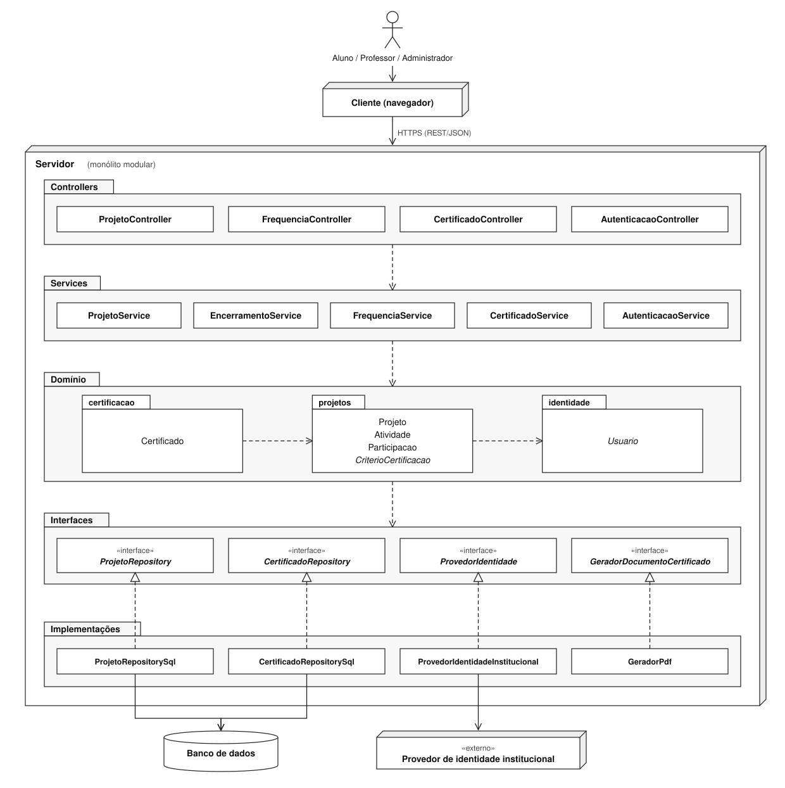

# Arquitetura

## Organização arquitetural

```
Cliente-servidor
+
Monólito modular
+
Organização em camadas (Clean Architecture, com portas e adaptadores)
```

- **Cliente-servidor**: o cliente (navegador) acessa o servidor por HTTPS
- **Monólito modular**: o servidor é implantado como uma única aplicação,
  dividida nos módulos do domínio (`identidade`, `projetos` e
  `certificacao`)
- **Clean Architecture** (portas e adaptadores): o código é organizado em
  camadas, e as dependências apontam para o domínio

Com uma equipe pequena e a carga esperada, um monólito modular é mais simples
de manter do que serviços separados. Os módulos e as interfaces do domínio
permitem separar um módulo no futuro, se for necessário.

## Diagrama



- As setas tracejadas indicam dependência: controllers → services → domínio
  → interfaces
- As setas com triângulo vazado indicam implementação: cada implementação
  aponta para a interface que implementa
- Os módulos do domínio dependem em um único sentido: `certificacao` →
  `projetos` → `identidade`
- Nomes em itálico são interfaces

## Camadas

- **Controllers** (`...Controller`): recebem as requisições do cliente,
  identificam o usuário e chamam um service
- **Services** (`...Service`): executam os casos de uso; buscam os objetos no
  repository, chamam o domínio e salvam o resultado
- **Domínio**: objetos, regras de negócio e interfaces, descritos em
  `dominio.md`
- **Infraestrutura**: implementações dos repositories, do login
  institucional e da geração do arquivo do certificado

### Controllers

Todos recebem as requisições do cliente, identificam o usuário com
`AutenticacaoService` e chamam um service, sem regras de negócio

**ProjetoController**
- requisições sobre projetos, atividades, participantes e critérios
  - chama `ProjetoService`
- requisição de encerramento do projeto
  - chama `EncerramentoService`

**FrequenciaController**
- requisições de registro e remoção de presenças e de consulta de horas
  - chama `FrequenciaService`

**CertificadoController**
- requisições de listagem e download de certificados
  - chama `CertificadoService`

**AutenticacaoController**
- requisição de consulta do usuário logado, com nome e papel
  - chama `AutenticacaoService`

### Services

**ProjetoService**
- criar, editar e consultar projetos
- gerenciar atividades, participantes e critérios
  - busca o aluno a vincular com `ProvedorIdentidade.buscarPorMatricula`
- verifica as permissões com `podeCriarProjeto()`
- só aceita alterações do coordenador do projeto ou de um administrador

**EncerramentoService**
- encerrar o projeto e emitir os certificados
  - cria e salva um `Certificado` para cada resumo em `projeto.aprovados()`
- só aceita o coordenador do projeto ou um administrador

**FrequenciaService**
- registrar e remover presenças
- consultar as horas do aluno, por projeto e no total, e as horas de todos
  os participantes para o coordenador
- só o coordenador do projeto ou um administrador registra presenças e
  consulta as horas de todos os participantes

**CertificadoService**
- listar os certificados do aluno
- gerar o arquivo para download com `GeradorDocumentoCertificado`
  - só entrega certificados que pertencem ao usuário (`pertenceA(usuario)`)

**AutenticacaoService**
- identificar o usuário a partir do token, com
  `ProvedorIdentidade.identificar(token)`
  - usado por todos os controllers no início de cada requisição
- recusa tokens ausentes ou inválidos

### Infraestrutura

- `ProjetoRepositorySql` e `CertificadoRepositorySql`, implementações dos
  repositories, que acessam o banco de dados
- `ProvedorIdentidadeInstitucional`, que acessa o login da universidade
- `GeradorPdf`, que gera o arquivo do certificado

## Módulos

- **`identidade`**: usuários e papéis, a partir do provedor de identidade
- **`projetos`**: projetos, atividades, participantes, presenças, critérios
  de certificação e apuração da frequência
- **`certificacao`**: certificados emitidos e geração do arquivo para
  download

## Dependências

- Entre camadas: controllers → services → domínio
- A infraestrutura depende do domínio, pois implementa as interfaces
  definidas nele
- Entre módulos: `certificacao` → `projetos` → `identidade`, sem
  dependências no sentido contrário

## Interfaces relevantes

- `ProvedorIdentidade`: identificação dos usuários pelo login institucional
  - implementações: `ProvedorIdentidadeInstitucional` e
    `ProvedorIdentidadeTeste`
- `ProjetoRepository` e `CertificadoRepository`: salvar e buscar os
  agregados
  - implementações: `ProjetoRepositorySql` e `CertificadoRepositorySql`
- `GeradorDocumentoCertificado`: geração do arquivo do certificado
  - implementações: `GeradorPdf` e `GeradorDocumentoTeste`
- `CriterioCertificacao`: critérios de certificação, usada só dentro do
  domínio

## Comunicação

**Mecanismos**
- Cliente → servidor: requisições HTTPS para uma API REST, com dados em JSON
  - o arquivo do certificado é devolvido em PDF
- Dentro do servidor: chamadas de método entre camadas e módulos, na mesma
  aplicação
- Servidor → banco de dados: pelas implementações dos repositories
- Servidor → provedor de identidade: pela implementação de
  `ProvedorIdentidade`

**Decisões**
- A comunicação é síncrona, sem filas ou eventos, pois todos os módulos
  rodam na mesma aplicação
- O servidor não guarda sessão; cada requisição envia o token do login
  institucional, validado pelo `AutenticacaoService`
- O cliente só conversa com os controllers, e nunca com o banco de dados ou
  o provedor de identidade

## Persistência

- Banco de dados relacional, compartilhado pelos módulos
  - cada módulo tem as próprias tabelas, e um módulo não acessa as tabelas
    de outro
- Um repository por agregado, e cada agregado é salvo como uma unidade
- Cada caso de uso salva os dados em uma transação
  - ao encerrar um projeto, o projeto e os certificados são salvos na mesma
    transação
- O arquivo do certificado não é guardado; ele é gerado a cada download a
  partir dos dados salvos em `Certificado`

## Integrações externas

**Provedor de identidade institucional**
- O usuário faz login no serviço de login único da universidade, e o cliente
  recebe um token
- O servidor valida o token a cada requisição e obtém o usuário e o papel
  (`identificar(token)`)
- O servidor busca alunos pela matrícula para vinculá-los a projetos
  (`buscarPorMatricula(matricula)`)
- Se o provedor estiver indisponível, não é possível entrar no sistema

## API

Todas as rotas exigem o token no cabeçalho `Authorization: Bearer <token>`.

**ProjetoController**
- `GET /projetos`: listar projetos
- `POST /projetos`: criar projeto
- `GET /projetos/{id}`: consultar projeto, com atividades e participantes
- `PUT /projetos/{id}`: editar projeto
- `POST /projetos/{id}/encerramento`: encerrar projeto e emitir os
  certificados
- `POST /projetos/{id}/atividades`: criar atividade
- `PUT /projetos/{id}/atividades/{atividadeId}`: editar atividade
- `DELETE /projetos/{id}/atividades/{atividadeId}`: remover atividade
- `POST /projetos/{id}/participantes`: vincular aluno pela matrícula
- `DELETE /projetos/{id}/participantes/{matricula}`: desvincular aluno
- `PUT /projetos/{id}/criterios`: definir critérios de certificação

**FrequenciaController**
- `POST /projetos/{id}/atividades/{atividadeId}/presencas`: registrar
  presença pela matrícula
- `DELETE /projetos/{id}/atividades/{atividadeId}/presencas/{matricula}`:
  remover presença
- `GET /projetos/{id}/horas`: horas de todos os participantes do projeto
- `GET /me/horas`: horas do aluno, por projeto e no total

**CertificadoController**
- `GET /me/certificados`: listar os certificados do aluno
- `GET /certificados/{id}/arquivo`: baixar o certificado em PDF

**AutenticacaoController**
- `GET /me`: usuário logado, com nome e papel

**Respostas de erro**
- `401`: token ausente ou inválido
- `403`: usuário sem permissão para a operação
- `404`: recurso não encontrado
- `409`: operação recusada por uma regra de negócio, como alterar um
  projeto encerrado

## Justificativas GRASP

**Controller**
- Os services recebem cada operação vinda dos controllers e coordenam o
  domínio, sem conter regras de negócio

**Pure Fabrication**
- Services e controllers não são conceitos do domínio e existem para separar
  a coordenação e a comunicação com o cliente

## Coesão e acoplamento

**Coesão**
- Cada camada tem um papel: controllers recebem requisições, services
  coordenam os casos de uso e o domínio mantém as regras

**Acoplamento**
- As camadas só dependem das camadas mais internas

**Pontos de atenção**
- `EncerramentoService` é o único service que usa `projetos` e
  `certificacao` e é o ponto de maior acoplamento, mantido isolado nele

## Princípios SOLID

**SRP (Single Responsibility Principle)**
- Controllers recebem requisições, services coordenam e o domínio mantém as
  regras

**DIP (Dependency Inversion Principle)**
- Os services dependem das interfaces definidas no domínio, e as
  implementações ficam na infraestrutura
